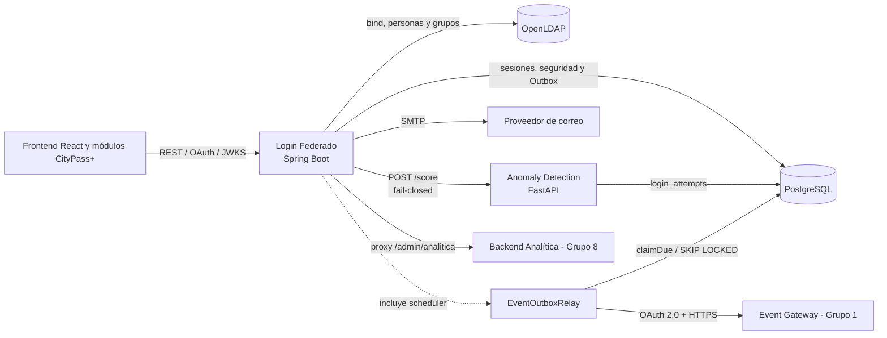

# 🏙️ CityPass+ | Módulo 2: Login Federado

**Plataforma de Servicios Urbanos Inteligentes**

[](https://java.com)
[](https://spring.io/projects/spring-boot)
[](https://www.openldap.org/)
[](https://jwt.io)
[](https://www.docker.com/)
[]()

---

## 📖 Descripción del Módulo

El **Módulo de Login Federado (LDAP + JWT)** es el núcleo de seguridad y gestión de
identidad de la plataforma **CityPass+**. Centraliza la autenticación de todos los
usuarios de la ciudad interactuando con un directorio de identidades corporativo
(OpenLDAP) y emitiendo tokens de acceso seguros (JWT con firma asimétrica RS256)
para proteger los endpoints de los 7 módulos restantes.

Es un **IdP propio**: autentica contra OpenLDAP (bind + `memberOf`), consulta un
microservicio de detección de anomalías antes de emitir tokens (fail-closed), firma
JWT con RS256 y expone JWKS para que las APIs validen sin llamar de vuelta. Incluye
el backend del panel administrativo (altas/bajas/grupos del directorio) que consume
el mismo contrato de tokens, y los flujos self-service de recupero de contraseña por
token de un solo uso.

La integración EDA usa un Outbox en PostgreSQL y un relay programado con lotes,
`SKIP LOCKED`, reintentos y *backoff*. El mismo backend expone además el proxy
autenticado del tablero HTML de Analítica para administradores globales.

Este proyecto forma parte de la asignatura **Desarrollo de Aplicaciones II (2c 2026)**, dictada por el profesor Andrés Sacco en la Universidad Argentina de la Empresa (UADE).

---

## 👥 Equipo de Trabajo (Grupo 2)

| Integrante | Rol | Módulo |
| :--- | :--- | :--- |
| **Abeledo, Federico** | Project Manager (PM) | Login Federado |
| **Francisco Frate, Delfina** | Scrum Master | Login Federado |
| **Hernandez, Nicolas** | Backend | Login Federado |
| **Opatich, Ignacio** | Frontend | Login Federado |
| **Ravaschio, Guido** | DevOps | Login Federado |
| **Wu, Antonio** | Security / Backend | Login Federado |

---

## 🏗️ Alineación con la Rúbrica (Evaluación)

Nuestro desarrollo está diseñado para cumplir con los estándares técnicos exigidos en la materia:

- 📐 **Arquitectura y Modelado:** Documentación de decisiones (ADRs), diagramas C4 y modelo Entidad-Relación.
- 🔐 **Seguridad Avanzada:** Autenticación LDAP, tokens JWT firmados asimétricamente (RS256), validación de claims, anti-enumeración, lockout anti fuerza bruta y contratos de seguridad documentados (diseño, token y anomalías).
- 📨 **Event Driven Architecture (EDA):** Eventos de login, refresh y logout persistidos en `event_outbox` y entregados al Event Gateway del Grupo 1 mediante un relay reintentable; ADR-010 documenta la decisión vigente.
- 🧪 **Testing:** Pruebas unitarias con JUnit 5/Mockito, integración PostgreSQL con Testcontainers e integración LDAP con UnboundID. JaCoCo define un gate de 60 % en `verify`; la limitación actual de CI se detalla en la sección de tests.
- 🚀 **DevOps & Cloud:** Entorno local 100% dockerizado (`docker-compose`), flujos CI/CD con GitHub Actions y despliegue cloud.
- 🧠 **Innovación (IA/I+D):** Lógica de detección de anomalías en los intentos de inicio de sesión (microservicio `anomaly-detection` con IsolationForest, integrado fail-closed).
- 📱 **UX/UI:** Interfaz Frontend desarrollada en React orientada a una experiencia de autenticación fluida.
- 🔄 **Gestión Ágil:** Framework Scrum, seguimiento con Jira y control de versiones bajo políticas de Git Flow.

---

## 🛠️ Stack Tecnológico

* **Backend:** Java 21, Spring Boot 3, Spring LDAP, Spring Security 6.
* **Directorio de Identidad:** OpenLDAP (overlays `memberof`, `refint`, `unique`, `constraint`, `ppolicy`).
* **Base de Datos:** PostgreSQL.
* **Firma Asimétrica:** JWT (Algoritmo RS256).
* **IA:** FastAPI + IsolationForest (microservicio `anomaly-detection`).
* **Frontend:** React 18, Vite, TypeScript, Tailwind CSS.
* **Testing:** JUnit 5, Mockito, Testcontainers PostgreSQL y UnboundID LDAP SDK.
* **Infraestructura:** Docker, Docker Compose, GitHub Actions.

---

## 📐 Arquitectura en 30 segundos



**Importante:** el microservicio `anomaly-detection` es obligatorio en desarrollo:
sin él corriendo, ningún login funciona (por diseño, fail-closed). El runtime carga
el bundle Isolation Forest **v4** y su política versionada; valida hashes, semántica
y orden de features al iniciar. Producción usa `ANOMALY_MODE=SHADOW`: una propuesta
ML `BLOCK` se registra pero se devuelve como `REVIEW`, por lo que el modelo no
bloquea accesos en ese modo. Las métricas vigentes son sintéticas y se documentan,
con sus límites, en `anomaly-detection/ML/ML_README.md` y ADR-009.

## Requisitos

- Docker + Docker Compose (único requisito para el modo rápido)
- JDK 21 + Maven 3.9+ (solo para correr la app fuera de Docker o los tests)

---

## 🚀 Levantar el entorno

El compose vive en `login-federado/docker-compose.yml` (el entorno se levanta desde esa carpeta).

### Modo recomendado: todo en Docker

```bash
cd login-federado
docker compose up -d
```

Levanta y siembra todo: OpenLDAP (configuración + seed automáticos e idempotentes),
PostgreSQL, el microservicio de anomalías y esta app en `http://localhost:8081`.

La primera vez genera automáticamente el par de claves RSA en `login-federado/keys/`
(`JwtKeyConfig` las crea si no existen — solo para desarrollo; en producción van como
secrets del proveedor cloud y `auto-generate-keys` se apaga).

### Modo alternativo: app fuera de Docker (hot reload)

```bash
cd login-federado
docker compose up -d openldap postgres anomaly-detection
mvn spring-boot:run
```

Swagger UI: <http://localhost:8081/docs>

---

## 🔍 Documentación de la API (Swagger)

La documentación interactiva la genera **SpringDoc** (OpenAPI 3.0) a partir de los
controllers, sin mantenimiento manual.

- **Swagger UI**: <http://localhost:8081/docs> — UI interactiva: explorar cada endpoint, ver cuerpos de request/response y probarlo desde el navegador.
- **Especificación JSON**: <http://localhost:8081/v3/api-docs> — OpenAPI crudo (mismo contenido que ve la UI). Se puede importar en [swagger.io](https://swagger.io/) o Postman con "Import from URL".
- **`login-federado/swagger.json`**: snapshot estático de la misma especificación, para importarla sin levantar el servicio.

Usar el botón **Authorize** (arriba a la derecha) con un access token (`Bearer <token>`) para probar los endpoints protegidos:

- `/panel/**` exige token de **delegado** (audience `citypass-admin-api`, grupo `delegados`, claim `module`) o de **admin global** (grupo `admin-global`).
- `/me` y `/me/change-password` exigen access token de persona (`token_use=human`).
- `/auth/**`, `/oauth/token`, `/.well-known/jwks.json`, `/health` y `/actuator/health` son públicos.

Las rutas del servicio quedan auto-documentadas (5 de `/auth`, perfil, JWKS, token
de servicio, health, el ABM del panel y el proxy de Analítica).

## Probar con Postman

Importar `login-federado/citypass-login-federado.postman_collection.json`.
**102 requests** en orden numérico: login, errores genéricos, refresh con rotación y
detección de reuso, JWKS, tokens de servicio, panel (incluye admin global y módulos),
lockout y anomalías. Los scripts capturan los tokens automáticamente entre requests.

---

## 🔌 Endpoints principales

| Método | Ruta | Qué hace |
|---|---|---|
| POST | `/auth/login` | Autentica y emite access + refresh token |
| POST | `/auth/refresh` | Canjea refresh por nuevo par (rotación; reuso ⇒ cadena revocada) |
| POST | `/auth/logout` | Revoca el refresh; denylista el access si se envía como Bearer. Token desconocido ⇒ 204 |
| POST | `/auth/forgot-password` | Emite token de recupero de un solo uso y lo manda por mail (nunca escribe LDAP) |
| POST | `/auth/reset-password` | Canjea el token y define la nueva contraseña en LDAP; revoca sesiones |
| GET | `/me` | Perfil de la persona autenticada (uid, nombre, mail, módulo, grupos) |
| POST | `/me/change-password` | Cambia la propia contraseña (actual + JWT); revoca todas las sesiones |
| GET | `/.well-known/jwks.json` | Clave pública para validar firmas RS256 |
| POST | `/oauth/token` | `client_credentials` para servicios (Basic auth, form-urlencoded) |
| GET | `/health`, `/actuator/health` | Healthchecks públicos; Actuator es el usado por despliegues y contenedores |
| GET | `/panel/anomaly-events` | Lista paginada de bloqueos anómalos con `riskScore` |
| POST | `/panel/anomaly-events/{id}/approve` | Autoriza un reintento contextual, temporal y de un solo uso |
| GET/POST/PUT/DELETE | `/panel/**` | Backend del panel (delegados + admin global; también `/modules` y `/admin/*`) |
| GET | `/admin/analitica` | Proxy del HTML de Analítica para Identidad (solo admin global) |

### Tablero de Analítica

`GET /admin/analitica` requiere un access token humano de `citypass-admin-web`
con el grupo `admin-global`. El backend reenvía ese mismo token como Bearer a
`${ANALYTICS_BASE_URL}${ANALYTICS_EMBED_PATH}` (por defecto, el endpoint HTTPS
de producción y `/embed/identidad`) y devuelve los bytes del HTML sin
modificarlos. También conserva `Content-Type`, `Cache-Control`,
`Content-Security-Policy`, `X-Content-Type-Options` y `Referrer-Policy`.

La respuesta no agrega `X-Frame-Options: DENY`, de modo que la CSP entregada
por Analítica controla el embebido. Analítica ya entrega en `/embed/identidad`
el HTML autocontenido definitivo (incluido `citypass-datos`), no el antiguo
`{"status":"ok"}`. Una respuesta `2xx` vacía o que no sea HTML se traduce a
`502`; los errores 401/403 del upstream conservan su estado y cuerpo, y los
fallos de red se traducen a `503`.

El frontend debe consumir exclusivamente
`https://api.citypass-login.pp.ua/admin/analitica`: no debe llamar directamente
a Analítica. El flujo utiliza un único access token humano, sin token de servicio,
y el token viaja solamente en `Authorization: Bearer ...`, nunca en la URL.

En desarrollo, un 401 devuelto por Analítica productiva es esperable: el JWT local
tiene issuer y claves RSA locales. No se debe copiar la clave privada productiva ni
relajar la validación. Las alternativas seguras son usar un ambiente de Analítica
que confíe en el JWKS local, probar el frontend local contra este backend productivo
una vez desplegado, o probar el proxy con un token emitido por el IdP productivo.

Configuración explícita del proxy (también disponible en `.env.example` y ambos
archivos de Docker Compose):

```dotenv
ANALYTICS_BASE_URL=https://citypass-backend-prod-becqetepcjbqa8c7.brazilsouth-01.azurewebsites.net
ANALYTICS_EMBED_PATH=/embed/identidad
ANALYTICS_CONNECT_TIMEOUT=3s
ANALYTICS_READ_TIMEOUT=15s
```

El procedimiento de release, rollback y smoke test está en
[`login-federado/docs/runbooks/analytics-dashboard-deploy.md`](login-federado/docs/runbooks/analytics-dashboard-deploy.md).

Login (notar **camelCase**, así lo implementa este proyecto):

```bash
curl -X POST http://localhost:8081/auth/login \
  -H "Content-Type: application/json" \
  -d '{"username":"jperez","password":"changeit123","clientId":"citypass-reclamos-web"}'
```

### Recupero y cambio de contraseña (self-service)

Flujo por **token de un solo uso**: la solicitud NUNCA escribe en LDAP, solo persiste
el hash de un token y envía un enlace por mail. LDAP se toca recién al canjearlo.

```bash
# 1) Pedir recupero (SIEMPRE 204, exista o no el usuario: anti-enumeración)
curl -X POST http://localhost:8081/auth/forgot-password \
  -H "Content-Type: application/json" \
  -d '{"uid":"jperez"}'

# 2) Canjear el enlace del mail con la nueva contraseña (204; 422 si venció/inválido)
curl -X POST http://localhost:8081/auth/reset-password \
  -H "Content-Type: application/json" \
  -d '{"token":"<token del enlace>","newPassword":"nuevaClaveFu553"}'

# 3) Cambio de contraseña estando logueado (requiere access token Bearer)
curl -X POST http://localhost:8081/me/change-password \
  -H "Authorization: Bearer <access_token>" \
  -H "Content-Type: application/json" \
  -d '{"currentPassword":"nuevaClaveFu553","newPassword":"otraClaveSegura9"}'
```

Al cambiar o restablecer la contraseña se revocan **todas** las sesiones (refresh
tokens) y se avanza `revoked_subject_cutoffs`, por lo que este backend rechaza los
access tokens anteriores. Las APIs externas que validan únicamente con JWKS no
consultan ese corte. La baja del panel hoy revoca refresh tokens, pero no avanza el corte.

**SMTP:** sin `spring.mail.host` el envío cae en modo dev: el enlace se imprime en
consola (`app.password-reset.debug-log: true`, default). Para enviar de verdad, copiar
`login-federado/.env.example` como `login-federado/.env` y completar las variables
`SPRING_MAIL_*` (guía de Gmail adentro); en producción además poner
`PASSWORD_RESET_DEBUG_LOG=false`. Ninguna falla de envío se propaga al cliente: la
respuesta es 204 y el detalle va al log. Las variables incluyen topes anti-abuso
(cooldown 5 min, máx 3/h por cuenta, 50/h por IP).

### Token de servicio (backend a backend)

`/oauth/token` consume **`application/x-www-form-urlencoded`** (no JSON) y solo admite
`grant_type=client_credentials`:

```bash
curl -u grupo2:grupo2-secret-dev -X POST http://localhost:8081/oauth/token \
  -d "grant_type=client_credentials"
```

Existen clientes oficiales `grupo1` a `grupo8` y los alias legacy `group1` y `group5`.
Sus secretos de desarrollo siguen el patrón `<client-id>-secret-dev` y se reemplazan
con variables `SVC_*_SECRET`. El token emitido NO trae `groups` ni `module`: su
identidad es el namespace.

---

## 👤 Usuarios de prueba (seed en `login-federado/ldap/config/01-seed.ldif`)

Password de todos: `changeit123`

| uid                | Módulo                              | Grupos notables |
|--------------------|-------------------------------------|---|
| delegado-rec       | Reclamos y Participación Ciudadana  | delegados |
| delegado-mov       | Movilidad Urbana Inteligente        | delegados |
| delegado-res       | Gestión de Residuos Inteligente     | delegados |
| delegado-emer      | emergencia                          | delegados |
| delegado-analitica | Espacios Públicos y Cultura         | delegados |
| delegado-eda       | Event Driven Architecture (EDA)     | delegados |
| delegado-esp       | Espacios Públicos y Cultura         | delegados |
| admin-global       | login (transversal)                 | admin-global |

## 🔑 Clientes registrados (`login-federado/src/main/resources/application.yml`)

| clientId | Tipo | Audience / Módulo |
|---|---|---|
| citypass-movilidad-web / residuos-web / reclamos-web / emergencias-web / espacios-web / analitica-web / eda-web | human | `citypass-<módulo>-api` |
| citypass-admin-web | human transversal | `citypass-admin-api` (único cliente que cruza módulos) |


El panel exige token de persona con audience `citypass-admin-api` (`token_use=human`):
los **delegados** operan el módulo de su claim `module` (nadie acepta el módulo por
parámetro: aislamiento estructural); los **admins globales** operan con `?module=` en
los endpoints regulares o sin módulo en `/panel/admin/**` (visión global del directorio).

Los bloqueos del detector se persisten con su score y razones. Un delegado puede
revisar y aprobar únicamente los de su módulo; el admin global puede abarcar todos.
La aprobación limpia el lockout del usuario y habilita durante 15 minutos un único
reintento desde el mismo `clientId`, IP y user-agent. El login debe repetirse: la
aprobación administrativa no emite tokens por sí sola.

---

## 📁 El directorio LDAP

Todo se siembra al primer arranque vía `login-federado/ldap/config/apply-config.sh`
(idempotente: cada bloque verifica y salta con "ya aplicado").

### Árbol

```
dc=citypass,dc=local
├── ou=admin          (misma estructura; rol global, ej. admin-global)
├── ou=Movilidad ──┬── ou=People     ← personas del módulo (inetOrgPerson)
│                  └── ou=Groups     ← grupos (groupOfNames), incluye delegados
├── ou=Residuos    (misma estructura)
├── ou=Reclamos    (misma estructura)
├── ou=Emergencias (misma estructura)
├── ou=Espacios    (misma estructura)
├── ou=Analitica   (misma estructura)
├── ou=Eda         (misma estructura)
├── ou=Login       ← IdP: solo People (admin-global vive acá, fuera del panel)

```


### Modelo de entradas

- **Persona** (`inetOrgPerson`): `uid`, `cn`, `sn`, `givenName`, `mail`, `userPassword`
  (hasheada `{SSHA}` por el servidor — nadie ve hashes) y `employeeNumber` (`U######`,
  secuencial global asignado por el panel).
- **Grupo** (`groupOfNames`): `cn` + `member` (valores SIEMPRE DNs absolutos, ej.
  `uid=jperez,ou=People,ou=Reclamos,dc=citypass,dc=local`).
- El grupo `delegados` existe **en cada módulo** y es reservado. Un delegado normal
  no puede eliminarlo ni dejarlo vacío; `admin-global` conserva actualmente una
  excepción que permite ambas operaciones y debe tratarse como una decisión de seguridad.
- `memberOf` es operacional: se calcula solo a partir de `member` (overlay) y hay que
  pedirlo explícitamente en cada búsqueda.

### Overlays activos (`apply-config.sh`)

| Overlay | Qué garantiza |
|---|---|
| `memberof` | Calcula `memberOf`; con refint integrado limpia al borrar grupos |
| `refint` | Integridad referencial de `member` |
| `unique` | Unicidad global de `uid`, `mail` y `employeeNumber` |
| `constraint` | `member` solo acepta DNs de personas o el placeholder → anti-anidamiento de grupos |
| `ppolicy` | Hashea contraseñas en claro al vuelo (`olcPPolicyHashCleartext`) |

### ACLs (resumen)

```
{0} userPassword  : self write · anonymous auth · panel-writer =wx · * none
{1} memberOf      : legible por todos
{2} ServiceAccounts: solo admin/readonly/panel-writer
{3} todo lo demás : admin write · panel-writer write · readonly read
                    · self read · anonymous auth
```

Efecto práctico: ni readonly ni nadie puede leer hashes; el login autentica por bind
(el servidor valida la contraseña, la app nunca la ve); el panel-writer puede escribir
el árbol pero tampoco lee `userPassword`.

---

## ⚙️ Notas operativas

- **Lockout**: 5 intentos fallidos en 15 minutos bloquean al usuario (respuesta
  indistinguible de credenciales inválidas). La vía normal es
  `POST /panel/people/{uid}/unlock`. Como recuperación operativa directa:

  ```bash
  docker exec citypass-db psql -U citypass -d login_federado \
    -c "DELETE FROM login_lockouts WHERE username='soporte1'; DELETE FROM login_attempts WHERE username='soporte1' AND successful=false;"
  ```

- **Los datos NO se pierden al reiniciar**: `schema.sql` es idempotente (sin `DROP`);
  las tablas y los refresh tokens sobreviven al reinicio de la app. Para resetear el
  entorno de desarrollo (vuelve a sembrar LDAP y vacía Postgres):

  ```bash
  cd login-federado && docker compose down -v && docker compose up -d
  ```

- **EDA**: login, refresh y logout se guardan primero en `event_outbox`.
  `EventOutboxRelay` entrega pendientes por `EventPublisher`; el modo default es
  `logging` y `EDA_PUBLISHER=http` usa el Gateway real del Grupo 1. La publicación
  HTTP obtiene un token de servicio `grupo2`; ver ADR-010 y `docs/eda/`. Al corte,
  los workflows CD asignan incorrectamente un secreto a `EDA_CLIENT_ID` (y el
  manual referencia `SVC_GROUPO2_SECRET`): corregir y verificar el `.env` antes de
  una demo o despliegue integrado.
- **Editar archivos bajo `login-federado/ldap/config/`**: deben tener fin de línea LF.
  El `.gitattributes` del repo lo fuerza — respetarlo o el bash del contenedor falla
  con `$'\r': command not found`.

---

## 🗂️ Estructura de paquetes (`login-federado/src/main/java/citypass/loginfederado/`)

```
config/      Beans de Spring Security, LDAP (readonly + panel-writer), JWT y claves
analytics/   Proxy autenticado y transparente del tablero HTML de Analítica
controller/  AuthController (/auth), OAuthTokenController (/oauth/token), ProfileController (/me),
             JwksController, HealthController
service/     AuthService, RefreshTokenService (rotación/reuso), LoginAttemptService, PasswordService
identity/    LdapDirectory (búsqueda + bind) y ClientRegistry (clientes registrados)
token/       Emisión de access tokens y claims (contrato §3)
security/    Filtros JWT y AnomalyRiskClient (fail-closed)
panel/       PanelController, autorización delegada, escritura al directorio, auditoría
event/       Outbox relay, payload EDA, publishers logging/HTTP y HealthController
metrics/     Modelo de eventos crudos de login, refresh y logout
exception/   Manejo centralizado: fallas genéricas de auth y respuestas 403/503 de anomalías
dto/ model/ repository/
```

---

## 🧪 Tests

```bash
cd login-federado
mvn test
mvn verify
```

- Los `*Test.java` cubren emisión y revocación de tokens, autenticación, Outbox,
  Analítica, reglas del panel y clientes registrados con JUnit 5 y Mockito.
- Los siete `*IT.java` usan Testcontainers únicamente para PostgreSQL; las pruebas
  LDAP usan UnboundID. El `pom.xml` todavía no configura Maven Failsafe, por lo que
  esos `*IT` no se ejecutan automáticamente con `mvn test` ni `mvn verify`.
- `mvn verify` genera el reporte y aplica **JaCoCo ≥ 60 % de cobertura de líneas**
  sobre las clases no excluidas. Reporte: `target/site/jacoco/index.html`.
- El CI actual ejecuta `mvn test jacoco:report`: publica resultados unitarios, pero
  no corre los `*IT` ni aplica el gate ligado a la fase `verify`.
- La CI de `anomaly-detection` ejecuta `unittest`; al corte existen 62 métodos de
  prueba y la auditoría informa ejecución verde con scikit-learn 1.5.2, sin warnings
  de incompatibilidad del artefacto v4.

---

## 📚 Entrega documental — TASK-171

La actualización **“Actualización de Documentación Técnica y Diagramas UML
Finales”** se recorre desde
[`login-federado/docs/README.md`](login-federado/docs/README.md).

Incluye:

- matriz de trazabilidad contra la rúbrica;
- C4 niveles 1–3, vistas 4+1 y despliegues;
- secuencias de los flujos críticos;
- historias, casos de uso UML y entidad-relación;
- contrato HTTP y decisiones arquitectónicas;
- EDA, Outbox y contratos de eventos;
- integración inter-squad y casos transversales;
- estrategia de testing y limitaciones conocidas;
- guion reproducible de demo con datos simulados y eventos reales.

La documentación de Sprints, retrospectivas y sprint reviews queda expresamente
fuera de esta tarea.
