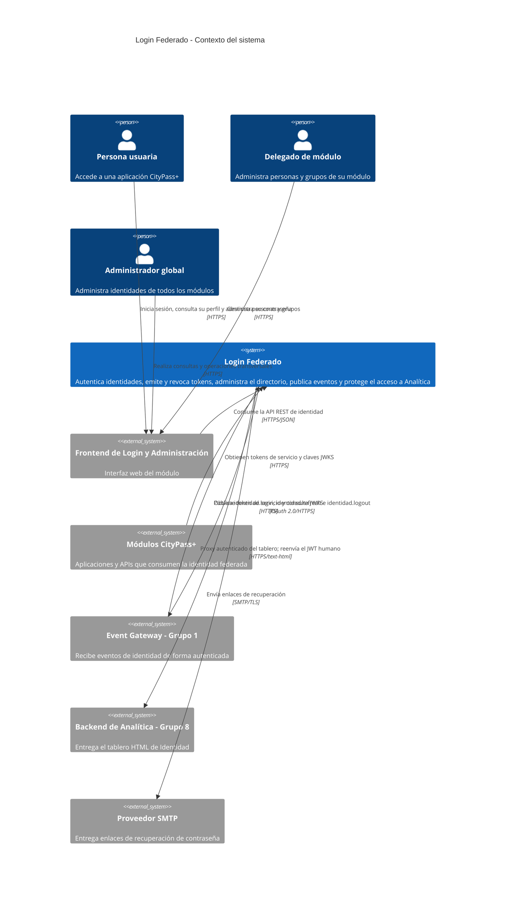

# C4 — Contexto del sistema (nivel 1)

**Sistema de interés:** Módulo de Login Federado e Identidad de CityPass+
**Fecha de revisión:** 19 de noviembre de 2026

El nivel de contexto presenta personas y sistemas externos directamente relacionados con Login Federado. Los detalles de tecnología, almacenamiento y despliegue se reservan para los niveles siguientes.

## Responsabilidad y límites

- Login Federado centraliza autenticación humana, sesiones renovables, identidad de servicios, perfil y administración del directorio.
- Los módulos consumidores validan JWT localmente mediante JWKS; no consultan al IdP en cada request.
- La lógica de movilidad, residuos, reclamos, emergencias, espacios, Analítica y EDA queda fuera del sistema de interés. Login solo integra sus contratos de identidad, eventos y tablero.
- OpenLDAP, PostgreSQL y detección de anomalías son contenedores internos del módulo y se muestran en el nivel 2, no como sistemas externos de este contexto.
- Los eventos se guardan primero en `event_outbox`; un relay programado los entrega al Gateway o al adaptador de logging con reintentos y *backoff*. La salida HTTP se habilita con `EDA_PUBLISHER=http` y las variables `EDA_*`.
- `GET /admin/analitica` exige `admin-global`, reenvía el Bearer token al backend de Analítica y propaga su HTML y encabezados permitidos.

## Correspondencia con C4

El alcance es un único sistema de software. Todos los elementos externos son personas o sistemas directamente conectados al sistema de interés; la infraestructura se representa exclusivamente en los diagramas de despliegue.
