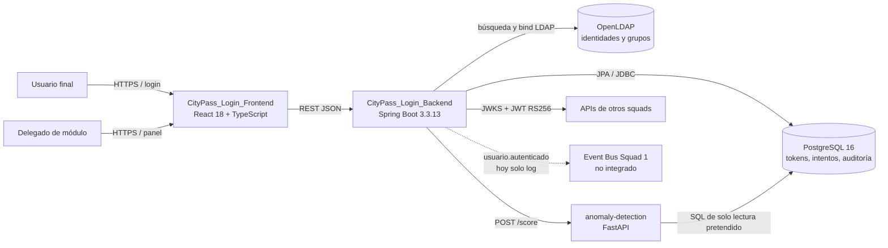
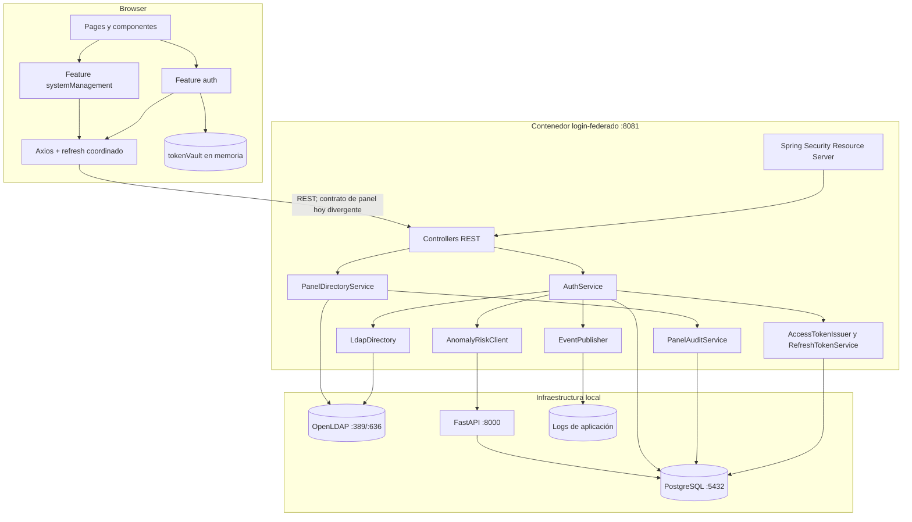
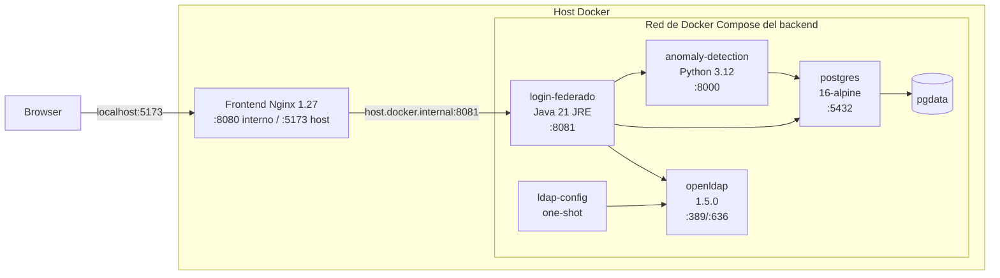
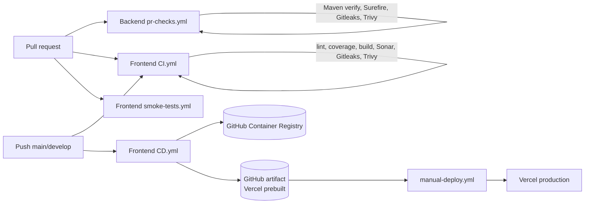

# Arquitectura y despliegue

Estas vistas representan el estado comprobado en los repositorios backend y frontend al 14 de noviembre de 2026. Las líneas punteadas indican una integración prevista o incompleta, no un flujo productivo.

## C4 — contexto

Los consumidores validan localmente JWT mediante `/.well-known/jwks.json`. No hay introspección ni sesión HTTP compartida.

## C4 — contenedores y componentes principales

### Responsabilidades

| Contenedor | Responsabilidad | Persistencia |
|---|---|---|
| Frontend | navegación, formularios, caché, token en memoria y renovación | ninguna persistente |
| Spring Boot | autenticación, emisión/validación JWT, refresh, lockout y panel | PostgreSQL + LDAP |
| OpenLDAP | fuente de verdad de personas, contraseñas, estado y grupos | DIT LDAP |
| PostgreSQL | refresh tokens, intentos y auditoría del panel | tres tablas de `schema.sql` |
| FastAPI | features históricas y decisión de riesgo | lee `login_attempts` |

## Despliegue local real

No se configura TLS, balanceador, réplica, observabilidad central ni orquestador cloud en el backend.

## CI/CD y cloud comprobados

El frontend sí define publicación y despliegue Vercel. El backend solo tiene validación de PR/push en un único workflow y no publica ni despliega una imagen. `smoke-tests.yml` pertenece al frontend y verifica únicamente HTML servido por Nginx.

## Vista 4+1 resumida

- Lógica: capas controller/service/repository/config, más adaptadores LDAP, riesgo y eventos.
- Desarrollo: monorepo backend con dos servicios; frontend Feature-Driven en repositorio separado.
- Procesos: login síncrono; publicación de evento síncrona al logger; refresh transaccional en SQL.
- Física: cinco servicios Compose del backend y un contenedor frontend separado.
- Escenarios: login, refresh/logout, client credentials y CRUD LDAP administrativo; vea [interacciones](04-sequence-login.md).
