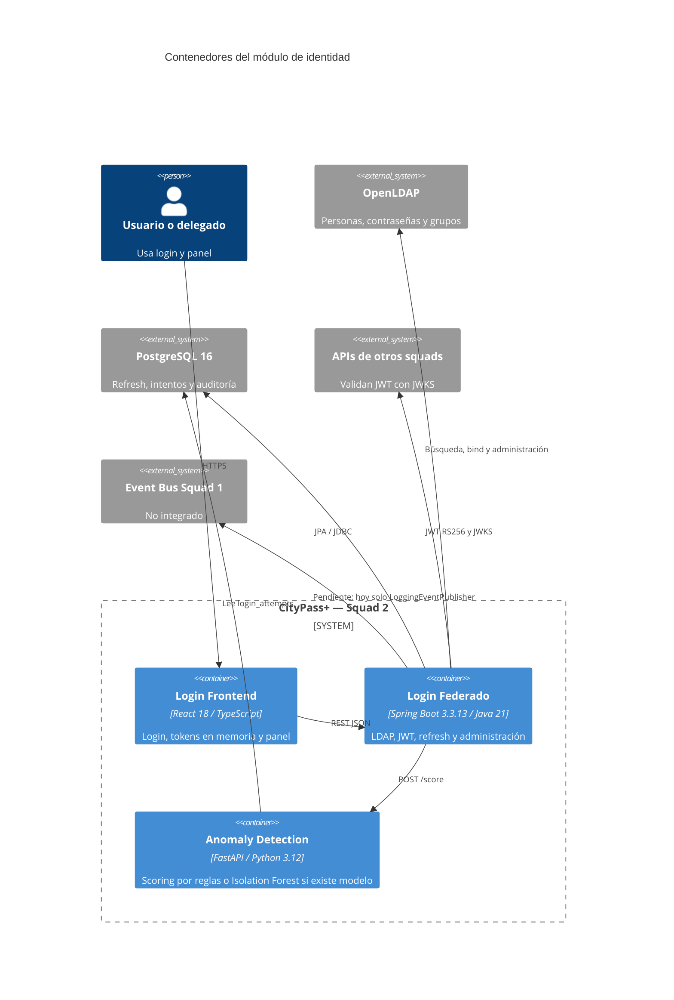

# C4 Container Diagram — CityPass+ (Nivel 2)

Estado auditado al 14 de noviembre de 2026. Se muestran contenedores comprobados; el Event Bus figura como integración pendiente.

## Estado de integración

- La autenticación frontend/backend coincide en login, refresh y logout.
- El panel no es interoperable todavía: el frontend usa rutas inglesas y el backend españolas.
- Sin `models/isolation_forest.pkl`, FastAPI usa reglas determinísticas.
- `usuario.autenticado` se escribe al log; no existe publicación a un broker.
