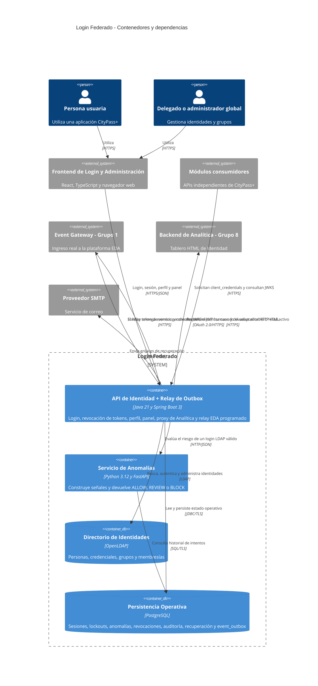

# C4 — Contenedores (nivel 2)

**Sistema de interés:** Módulo de Login Federado e Identidad de CityPass+
**Fecha de revisión:** 19 de noviembre de 2026

En C4, un contenedor es una aplicación o almacén de datos ejecutable de manera independiente. Este diagrama representa la arquitectura lógica de ejecución y no una topología cloud específica.

## Decisiones y límites

- OpenLDAP es la fuente de verdad de identidades, credenciales, estado de cuenta y membresías.
- PostgreSQL conserva once tablas operativas: refresh tokens, intentos, lockouts, evaluaciones y bloqueos de anomalías, revocaciones de access tokens, cortes de revocación por sujeto, auditoría, recuperación y Outbox; no almacena contraseñas.
- El servicio FastAPI consulta `login_attempts` y es una dependencia sincrónica del login. La API aplica fallo cerrado cuando no puede evaluarse el riesgo.
- La API persiste los eventos de login, refresh y logout en `event_outbox`. `EventOutboxRelay`, ejecutado dentro del mismo proceso Spring Boot, reclama filas con `SKIP LOCKED` y aplica reintentos con *backoff*; no es un contenedor desplegable separado.
- El proxy de Analítica solo está disponible para `admin-global`; el frontend nunca consume directamente el backend externo.
- El pipeline `anomaly-detection/ML` es una capacidad de desarrollo offline, no un contenedor runtime; se representa en la vista de desarrollo 4+1.
- La topología, las réplicas, los volúmenes y los nodos cloud se documentan en los diagramas de despliegue 12 y 13.
