# C4 — Componentes de la API de Identidad (nivel 3)

**Contenedor en alcance:** API de Identidad Spring Boot
**Fecha de revisión:** 19 de noviembre de 2026

Este nivel descompone únicamente el contenedor Spring Boot. OpenLDAP, PostgreSQL, FastAPI y los servicios externos aparecen como dependencias de sus componentes.

```mermaid
C4Component
    title API de Identidad - Componentes principales

    Container_Boundary(api, "API de Identidad - Spring Boot") {
        Component(authApi, "API de Autenticación y Perfil", "AuthController y ProfileController", "Login, refresh, logout, perfil y contraseñas")
        Component(oauthApi, "API OAuth", "OAuthTokenController", "Emite tokens de servicio")
        Component(jwksHealthApi, "API JWKS y Salud", "JwksController, HealthController y Actuator", "Publica claves y estado operativo")
        Component(panelApi, "API de Administración", "PanelController", "Personas, grupos, lotes y vistas globales")
        Component(analyticsApi, "API de Analítica", "AnalyticsController", "Autoriza admin-global y expone GET /admin/analitica")

        Component(authService, "Orquestación de Autenticación", "AuthService y LoginAttemptService", "Aplica lockout, LDAP, riesgo, tokens y eventos")
        Component(sessionService, "Gestión de Sesiones", "RefreshTokenService", "Emisión, rotación, reuso y revocación")
        Component(passwordService, "Gestión de Contraseñas", "PasswordService y limitadores", "Recuperación, cambio y revocación")
        Component(panelServices, "Servicios del Panel", "PanelPersonService, PanelGroupService y PanelAccountService", "Reglas y operaciones administrativas")
        Component(panelAuth, "Autorización del Panel", "PanelAuthorization", "Valida audience, tipo, versión, rol y módulo")
        Component(revocation, "Revocación de Access Tokens", "TokenRevocationService y RevokedJwtValidator", "Denylist por jti y corte temporal por sujeto")

        Component(identity, "Adaptador de Identidad", "LdapDirectory y ClientRegistry", "Directorio y registro de clientes")
        Component(token, "JWT y Claves RSA", "AccessTokenIssuer y JwtKeyConfig", "Firma tokens humanos y de servicio; publica clave")
        Component(riskClient, "Cliente de Riesgo", "AnomalyRiskClient", "Invoca POST /score con timeout y fallo cerrado")
        Component(outbox, "Servicio de Outbox", "EventOutboxService", "Persiste eventos y administra estados, reintentos y backoff")
        Component(relay, "Relay de Outbox", "EventOutboxRelay", "Reclama lotes pendientes de forma programada")
        Component(eventPort, "Puerto de Eventos", "EventPublisher", "Abstrae la entrega de hechos de identidad")
        Component(eventAdapters, "Adaptadores de Eventos", "LoggingEventPublisher y EdaHttpEventPublisher", "Registra localmente o publica datos de negocio por HTTP")
        Component(analyticsClient, "Cliente de Analítica", "AnalyticsClient", "Reenvía el Bearer token y valida la respuesta HTML")
        Component(repositories, "Repositorios Operativos", "Spring Data JPA / JDBC", "Once tablas de sesiones, seguridad, evaluaciones, auditoría, recuperación y Outbox")
    }

    ContainerDb(ldap, "OpenLDAP", "Directorio de identidades")
    ContainerDb(db, "PostgreSQL", "Persistencia operativa")
    Container(risk, "Servicio de Anomalías", "FastAPI", "Evaluación de riesgo")
    System_Ext(gateway, "CityPass Event Gateway", "Plataforma EDA")
    System_Ext(analytics, "Backend de Analítica", "Tablero HTML de Identidad")
    System_Ext(mail, "Proveedor SMTP", "Correo de recuperación")

    Rel(authApi, authService, "Delega login, refresh y logout")
    Rel(authApi, passwordService, "Delega perfil y contraseñas")
    Rel(oauthApi, token, "Emite token de servicio")
    Rel(jwksHealthApi, token, "Obtiene material público de la clave")
    Rel(panelApi, panelAuth, "Autoriza actor y alcance")
    Rel(panelApi, panelServices, "Ejecuta operaciones administrativas")
    Rel(panelApi, repositories, "Consulta auditoría y anomalías")
    Rel(analyticsApi, panelAuth, "Exige administrador global")
    Rel(analyticsApi, analyticsClient, "Solicita el tablero")

    Rel(authService, identity, "Busca y autentica")
    Rel(authService, riskClient, "Solicita evaluación")
    Rel(authService, token, "Emite access token")
    Rel(authService, sessionService, "Emite o rota refresh token")
    Rel(authService, outbox, "Encola login y refresh")
    Rel(sessionService, outbox, "Encola logout")
    Rel(authService, revocation, "Denylista el access token opcional en logout")
    Rel(passwordService, identity, "Revalida identidad")
    Rel(passwordService, panelServices, "Actualiza contraseña LDAP")
    Rel(passwordService, sessionService, "Revoca sesiones")
    Rel(passwordService, revocation, "Avanza el corte de revocación del sujeto")
    Rel(passwordService, mail, "Envía enlace", "SMTP")
    Rel(panelServices, identity, "Administra el directorio")
    Rel(panelServices, repositories, "Registra auditoría")
    Rel(panelServices, sessionService, "Revoca sesiones al deshabilitar")

    Rel(authService, repositories, "Registra intentos")
    Rel(sessionService, repositories, "Administra cadenas")
    Rel(passwordService, repositories, "Administra recuperación")
    Rel(identity, ldap, "Lee, autentica y modifica", "LDAP")
    Rel(repositories, db, "Lee y escribe", "JDBC")
    Rel(outbox, repositories, "Persiste y actualiza event_outbox")
    Rel(relay, outbox, "Reclama pendientes y registra resultado")
    Rel(relay, eventPort, "Entrega cada evento reclamado")
    Rel(riskClient, risk, "Evalúa", "HTTP/JSON")
    Rel(eventAdapters, eventPort, "Implementan")
    Rel(eventAdapters, oauthApi, "Obtiene token grupo2 en modo HTTP")
    Rel(eventAdapters, gateway, "Publica evento en modo HTTP", "HTTPS/JSON")
    Rel(analyticsClient, analytics, "GET del embed con Bearer token", "HTTPS/text-html")
```

## Paquetes representados

| Paquete | Responsabilidad principal |
| --- | --- |
| `controller` | Contratos REST de autenticación, OAuth, JWKS y perfil |
| `service` | Casos de uso de autenticación, sesión y contraseñas |
| `panel` | Administración, autorización, reglas y auditoría |
| `identity` | Acceso a LDAP y registro de clientes |
| `token` | Construcción y firma de JWT |
| `security` | Integración con la evaluación de riesgo |
| `event` | Outbox, relay, mapeo de payload y adaptadores EDA |
| `analytics` | Proxy autenticado y cliente del tablero externo |
| `metrics` | Modelo de hechos crudos de login, refresh y logout |
| `repository` y `model` | Persistencia PostgreSQL |
| `config` | Seguridad, LDAP, JWT, panel, contraseñas y EDA |

## Alcance y simplificaciones

- Los componentes agrupan clases con una responsabilidad común; no equivalen uno a uno a cada clase Java.
- El pipeline experimental `anomaly-detection/ML` no pertenece al contenedor Spring Boot y se excluye de este nivel.
- La solicitud de autenticación solo encola el evento. La entrega posterior desde el Outbox es asíncrona respecto del request; cada intento HTTP del relay sí es sincrónico y tiene timeouts.
