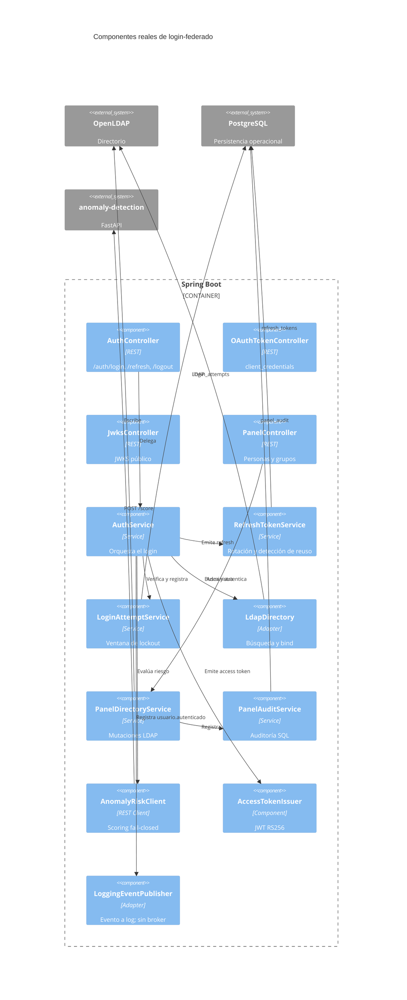

# C4 Component Diagram — Login Federado (Nivel 3)



## Paquetes reales

```text
citypass.loginfederado
├── controller/     Auth, JWKS y OAuth
├── service/        login, refresh y lockout
├── identity/       LDAP y registro de clientes
├── security/       cliente de riesgo
├── panel/          autorización, directorio y auditoría
├── token/          emisión JWT
├── event/          puerto y adaptador de logging
├── repository/     Spring Data JPA
├── config/         Security, LDAP, RSA y properties
└── exception/      errores REST centralizados
```
