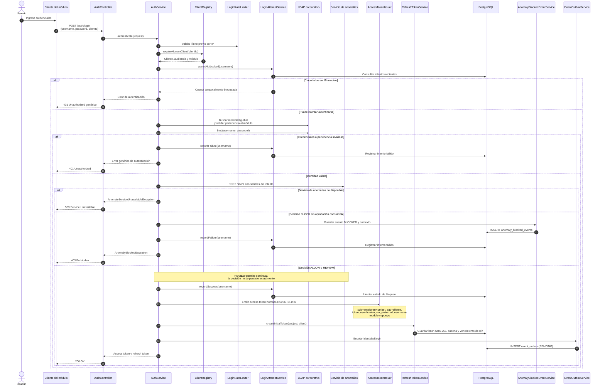

# Secuencia — Inicio de sesión federado

**Fecha de revisión:** 19 de noviembre de 2026
**Endpoint:** `POST /auth/login`

El inicio de sesión humano exige `username`, `password` y `clientId`. Las fallas de identidad, contraseña, cliente, módulo y lockout comparten el mismo `401`; anomalías usa categorías explícitas `403`/`503` sin exponer puntaje, razones ni datos de la cuenta.

## Consideraciones técnicas

- El límite de bloqueo se evalúa por identidad: cinco fallos dentro de una ventana de quince minutos.
- La evaluación de anomalías es obligatoria y opera en modo *fail closed*: una indisponibilidad impide el acceso.
- Una decisión `BLOCK` queda en `anomaly_blocked_events`. Una aprobación administrativa vigente y coincidente puede consumirse una única vez en un intento posterior.
- El refresh token se almacena únicamente mediante su hash SHA-256; el valor en claro sólo se entrega al cliente.
- `identidad.login` se persiste en `event_outbox`; la entrega al adaptador configurado ocurre luego en el relay y no bloquea la respuesta de login.
