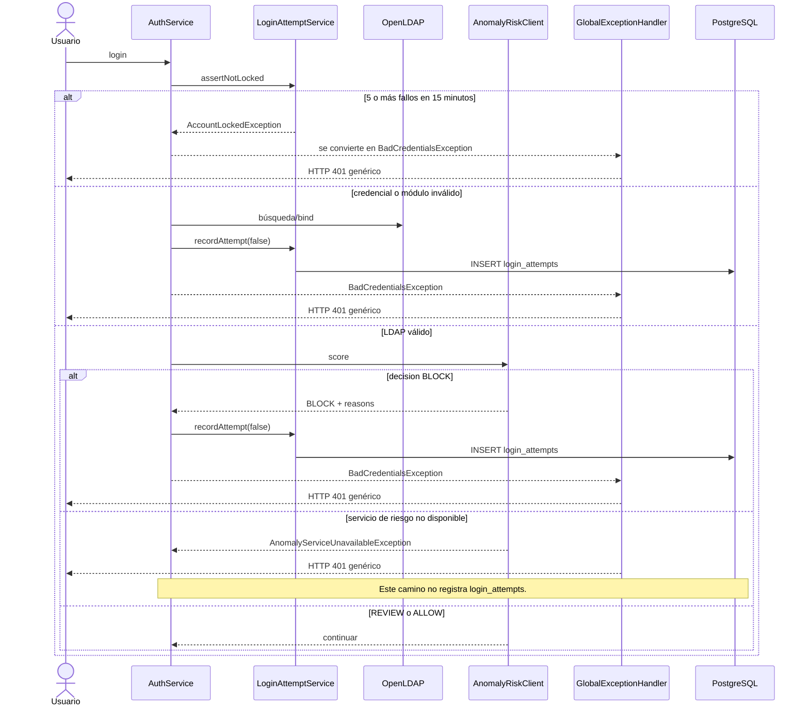
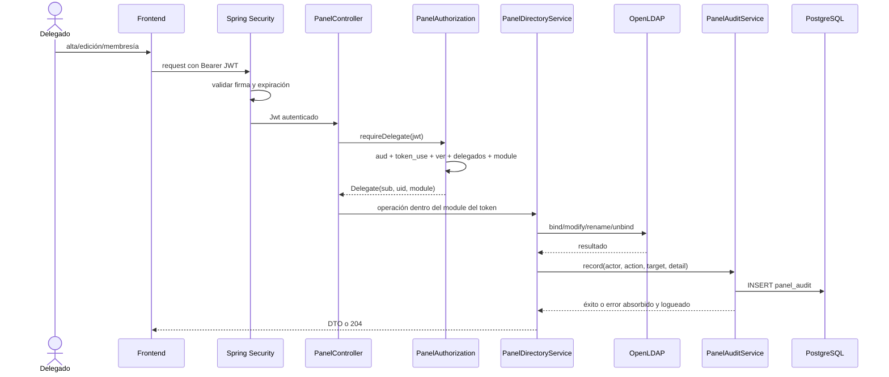
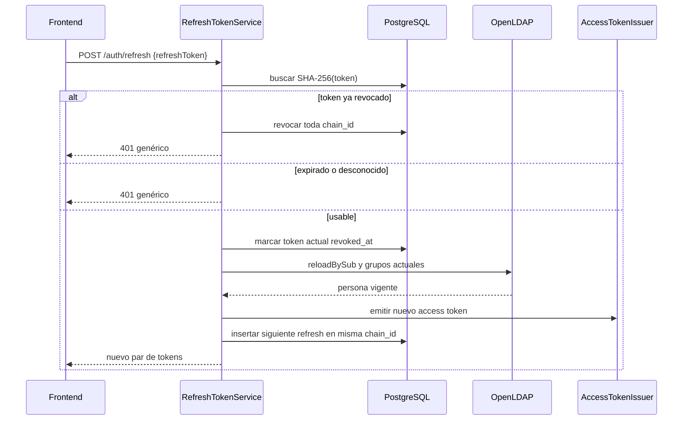

# Diagramas de interacción

## Flujo 1 — login, riesgo, tokens y evento

```mermaid
sequenceDiagram
    actor U as Usuario
    participant F as Frontend
    participant C as AuthController
    participant A as AuthService
    participant L as LoginAttemptService
    participant D as OpenLDAP
    participant R as anomaly-detection
    participant P as PostgreSQL
    participant T as Token services
    participant E as LoggingEventPublisher

    U->>F: usuario + contraseña
    F->>C: POST /auth/login {username,password,clientId}
    C->>A: login(request, IP, User-Agent)
    A->>L: assertNotLocked(username)
    L->>P: contar fallos en últimos 15 min
    A->>D: buscar uid global
    A->>D: bind con DN y contraseña
    D-->>A: autenticado
    A->>R: POST /score
    R->>P: leer hasta 200 login_attempts
    R-->>A: ALLOW, REVIEW o BLOCK
    Note over R: Sin .pkl versionado usa reglas;<br/>REVIEW no se persiste como flag.
    A->>L: recordAttempt(success=true)
    L->>P: INSERT login_attempts
    A->>T: issueHuman + issueInitial
    T->>P: INSERT refresh_tokens (hash)
    T-->>A: JWT RS256 + refresh opaco
    A->>E: publish(usuario.autenticado)
    E-->>E: serializar JSON y escribir log
    A-->>F: 200 access_token + refresh_token
    F-->>U: sesión en memoria
```

El riesgo se consulta después de un bind LDAP exitoso, no antes. No existe la entidad `RawAuthenticationEvent`: el histórico real es `login_attempts`.

## Flujo 2 — fuerza bruta, anomalía o indisponibilidad



Aunque las clases `AnomalyBlockedException` y `AnomalyServiceUnavailableException` tienen handlers, `AuthService` convierte `BLOCK` directamente en `BadCredentialsException`. Todos estos caminos responden 401, no 403/503, para evitar enumeración; por tanto, una defensa que afirme 403/503 no coincide con el código.

## Flujo 3 — operación administrativa



No se publica un evento de dominio administrativo. La auditoría SQL es el único efecto secundario, y `PanelAuditService` absorbe fallos de persistencia; por ello no garantiza atomicidad LDAP/SQL ni auditoría inmutable a nivel de base.

## Flujo de refresh y detección de reuso


