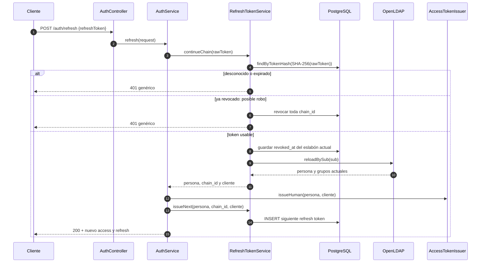

# Sequence Diagram — Rotación de Refresh Token

El refresh vive ocho horas, rota en cada uso y solo se persiste como hash. La relectura LDAP evita renovar permisos obsoletos o cuentas deshabilitadas.
