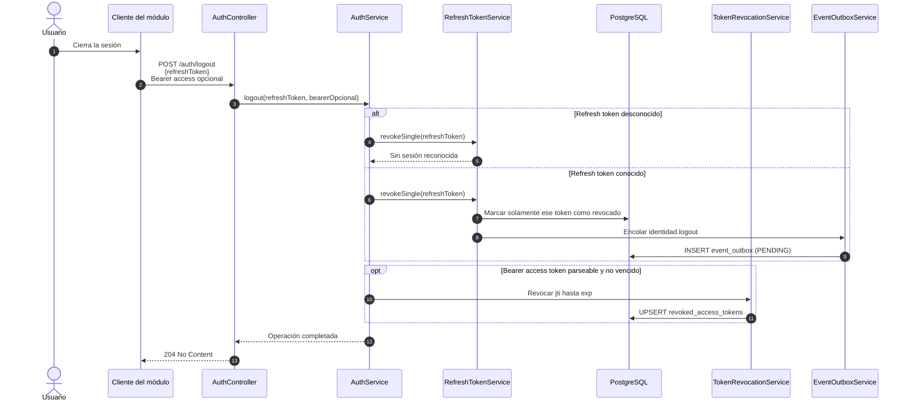

# Secuencia — Cierre de sesión

**Fecha de revisión:** 19 de noviembre de 2026
**Endpoint:** `POST /auth/logout`

El cierre de sesión recibe el refresh token en el cuerpo. El access token es opcional: si se envía como Bearer, su `jti` también queda revocado. La operación es idempotente hacia el cliente.

## Alcance de la revocación

- El endpoint revoca únicamente el refresh token presentado y no toda la cadena.
- Repetir la solicitud o enviar un token desconocido mantiene la respuesta `204 No Content`.
- Si el cliente omite el Bearer token, ese access token puede seguir válido hasta expirar; si lo presenta, este backend lo rechaza por denylist. Una API externa que solo valida JWKS no consulta esa tabla.
- Los cambios o recuperos de contraseña revocan refresh tokens y avanzan `revoked_subject_cutoffs`, que este backend consulta al validar access tokens. La deshabilitación administrativa hoy revoca los refresh tokens, pero no avanza ese corte.
