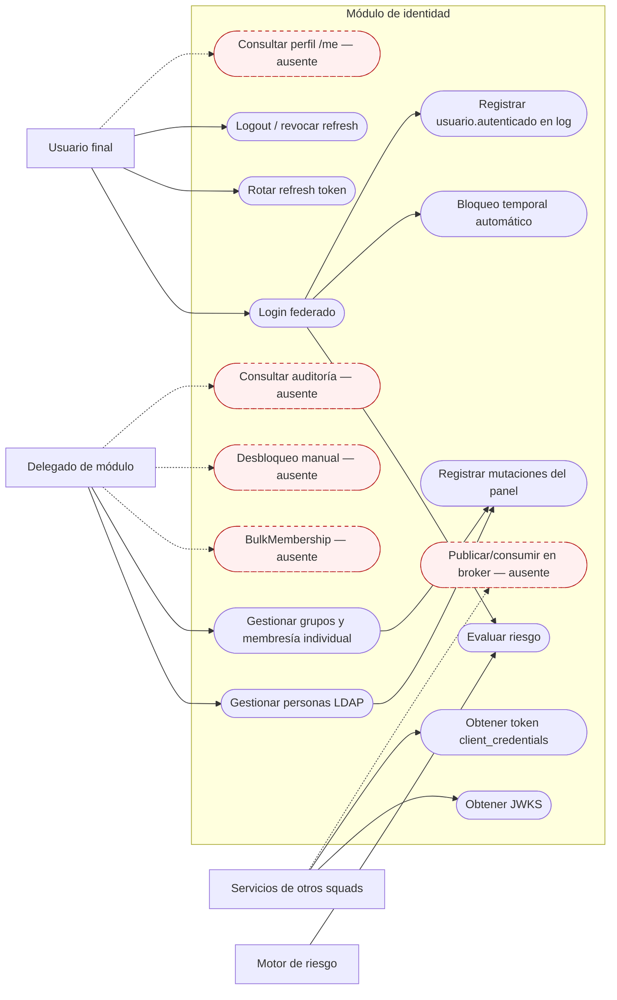

# Casos de uso

Mermaid no posee una notación UML de casos de uso oficial; se usa `flowchart`, que GitHub renderiza nativamente. El color distingue comportamiento implementado de contratos solicitados pero ausentes.

## Matriz de casos y evidencia

| Actor | Caso | Estado | Evidencia |
|---|---|---|---|
| Usuario | Login federado | Implementado | `POST /auth/login`, `AuthService`, bind LDAP |
| Usuario | Rotación de refresh | Implementado | `POST /auth/refresh`, cadena y detección de reuso |
| Usuario | Logout | Implementado | `POST /auth/logout`; revoca un refresh, no el access token vigente |
| Usuario | Consulta `/me` | Ausente | no existe controller ni mapping |
| Delegado | CRUD de personas | Implementado | `/panel/personas/**`; alta, edición, enable/disable y reset administrativo |
| Delegado | CRUD de grupos | Implementado | `/panel/grupos/**` y membresía individual |
| Delegado | Membresía masiva | Ausente | el frontend llama `/panel/group-memberships/bulk`, sin mapping backend |
| Delegado | Desbloqueo de fuerza bruta | Ausente como API | el lockout expira al salir los intentos de la ventana de 15 minutos |
| Delegado | Consultar auditoría | Ausente | se persiste `panel_audit`, pero no hay endpoint de lectura |
| Otros squads | Validar JWT | Implementado | JWT RS256 + JWKS; la validación ocurre en cada consumidor |
| Otros squads | Token de servicio | Implementado | `POST /oauth/token`, form-urlencoded + Basic |
| Motor ML | Evaluar login | Parcial | `/score`; sin modelo versionado se usan reglas |
| Plataforma EDA | Publicar/consumir eventos | Parcial/Ausente | solo `usuario.autenticado` a logger; no hay consumidor |

## Reglas de autorización del panel

El backend requiere un JWT válido con `aud` que contenga `citypass-admin-api`, `token_use=human`, `ver=1`, claim `module` y grupo `delegados`. El módulo operado siempre proviene del token; el backend no acepta un parámetro `module`.
