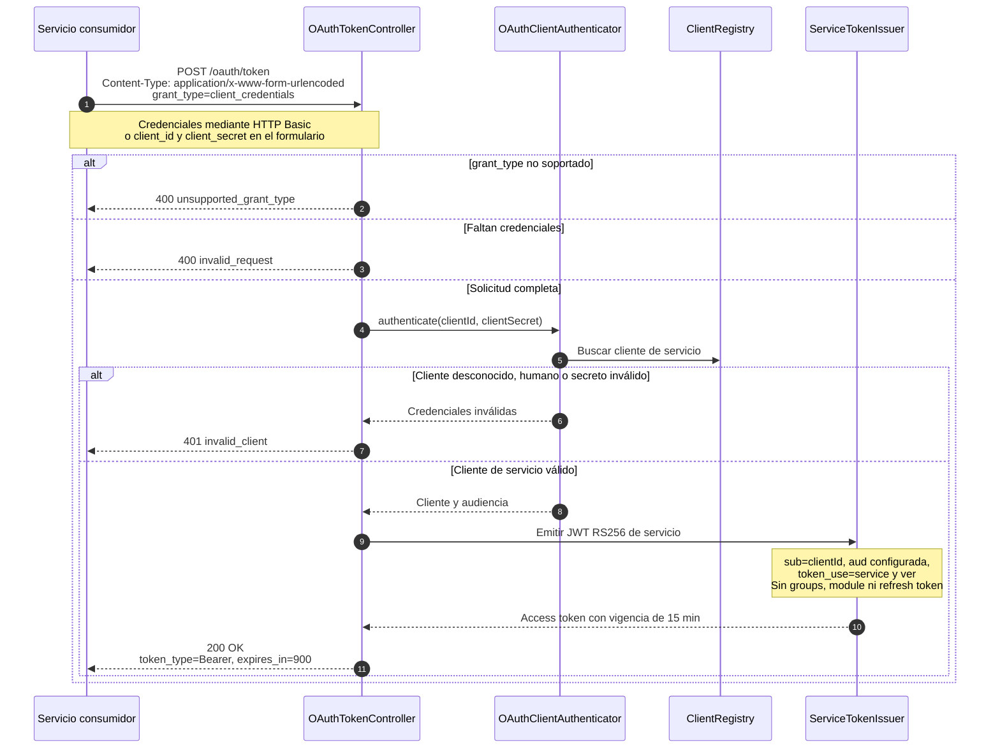

# Secuencia — OAuth 2.0 Client Credentials

**Fecha de revisión:** 19 de noviembre de 2026
**Endpoint:** `POST /oauth/token`

El flujo está destinado exclusivamente a integraciones máquina a máquina registradas como clientes de servicio.

Los clientes de servicio configurados actualmente incluyen los clientes oficiales `grupo1` a `grupo8` y los alias legacy `group1` y `group5`. La respuesta de error sigue el formato OAuth y no el contrato de autenticación humana.
