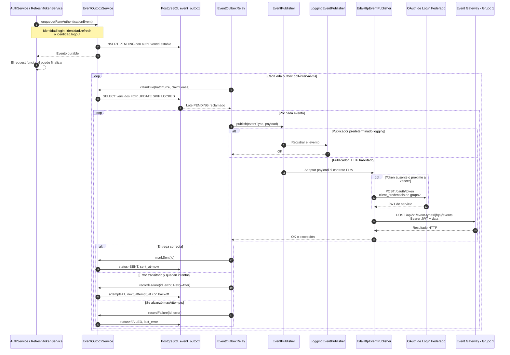

# Secuencia — Outbox y publicación de eventos de identidad

**Fecha de revisión:** 19 de noviembre de 2026

El backend produce eventos crudos de autenticación y los persiste antes de intentar su entrega. No calcula DAU, MAU ni agregados diarios; esas métricas corresponden a consumidores posteriores del flujo EDA.

## Garantías y límites

- El `id` de `event_outbox` coincide con `authEventId`; un reintento conserva la identidad del evento para permitir deduplicación en EDA.
- El lease y `FOR UPDATE SKIP LOCKED` evitan que dos instancias reclamen simultáneamente la misma fila.
- El *backoff* es exponencial y respeta un `Retry-After` de HTTP 429 cuando exige una espera mayor.
- La persistencia del Outbox usa una transacción propia y se ejecuta con manejo de error de mejor esfuerzo: un fallo al encolar queda registrado, pero no revierte el login, refresh o logout ya completado.
- `SENT` y `FAILED` quedan disponibles para operación; el código actual no purga automáticamente filas históricas.
- `EdaHttpEventPublisher` envía únicamente los datos de negocio. El Event Gateway completa la metadata del envelope.
