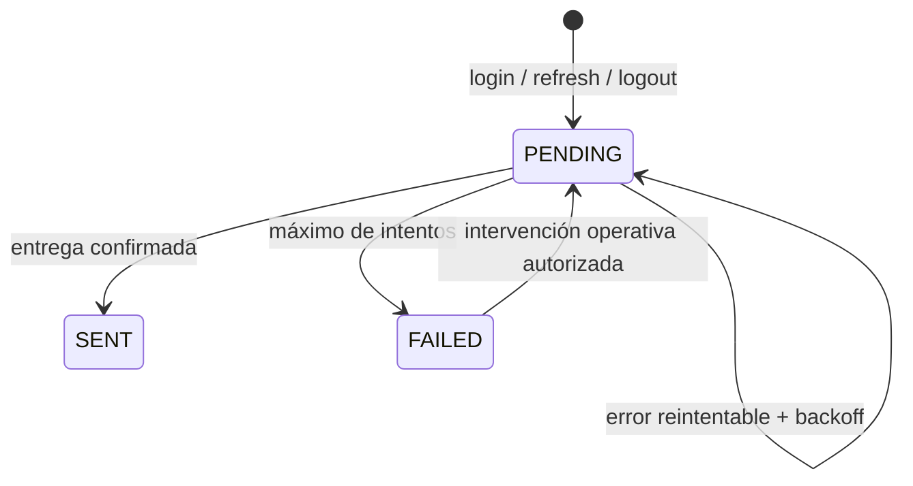

# EDA — contratos, Outbox y operación

**Última revisión:** 19 de noviembre de 2026

## Alcance

Login Federado publica hechos de autenticación; no necesita consumir eventos para cumplir su responsabilidad actual. Los eventos se persisten primero en `event_outbox` y un relay los entrega al adaptador configurado. ADR-010 reemplaza la publicación directa descrita originalmente en ADR-006.

## Contratos versionados

| Hecho | Tipo lógico | Archivo |
|---|---|---|
| Login exitoso | `identidad.login` | `LoginExitoso.json` |
| Token renovado | `identidad.refresh` | `TokenRenovado.json` |
| Sesión cerrada | `identidad.logout` | `SesionCerrada.json` |

Los tres comparten `authEventId`, `actorSub`, `occurredAt`, `username`, `department`, `clientId`, `chainId`, `ipAddress` y `userAgent`. No incluyen tokens ni hashes de refresh tokens.

## Flujo de publicación



El relay reclama lotes con `FOR UPDATE SKIP LOCKED`, libera la transacción antes de llamar a EDA y conserva el id entre reintentos. La entrega es al menos una vez; el consumidor debe deduplicar.

## Configuración

```text
EDA_PUBLISHER=http
EDA_GATEWAY_URL=https://gateway.example
EDA_TOKEN_URL=https://identidad.example
EDA_EVENT_PATH=/api/v1/events
EDA_TOKEN_PATH=/oauth/token
EDA_CLIENT_ID=grupo2
EDA_CLIENT_SECRET=<secret>
```

En local puede utilizarse `EDA_PUBLISHER=logging`; el Outbox sigue existiendo y el relay marca el evento tras enviarlo al adaptador de logging.

## Monitoreo

```sql
SELECT status, count(*)
FROM event_outbox
GROUP BY status;

SELECT id, event_type, status, attempts, next_attempt_at, last_error
FROM event_outbox
WHERE status IN ('PENDING', 'FAILED')
ORDER BY created_at;
```

Una fila `FAILED` no se reintenta automáticamente. La causa debe corregirse antes de volver a `PENDING`; conservar `id` y payload para no romper la deduplicación.

## Limitaciones aceptadas

- El Outbox es de mejor esfuerzo y no comparte una transacción estricta con todos los cambios de autenticación.
- No garantiza orden global.
- Puede entregar duplicados.
- No existe purga automática de filas `SENT`.
- Las credenciales y URLs productivas viven fuera del repositorio.

## Hallazgos operativos abiertos

- `.github/workflows/CD.yml` asigna `secrets.SVC_GRUPO2_SECRET` a `EDA_CLIENT_ID`; ese valor debe ser el identificador literal `grupo2`, no el secreto.
- `.github/workflows/manual-deploy.yml` usa además el nombre mal escrito `SVC_GROUPO2_SECRET`. Verificar el `.env` generado antes de una demo o despliegue.
- `application.yml` declara `eda.connect-timeout-millis` y `eda.read-timeout-millis`, pero `EdaProperties` enlaza `connectTimeout` y `readTimeout` como `Duration`. Las variables `EDA_*_TIMEOUT_MILLIS` no controlan hoy esos campos; se aplican los defaults 3 s y 5 s.

## Referencias

- ADR-006: decisión histórica y abstracción inicial.
- ADR-010: decisión vigente de Outbox.
- `10-sequence-metricas.md`: secuencia completa de publicación.
- `13-cloud-deployment-prod.md`: topología y controles operativos.
- `demo-hito-2.md`: verificación durante la demostración.
