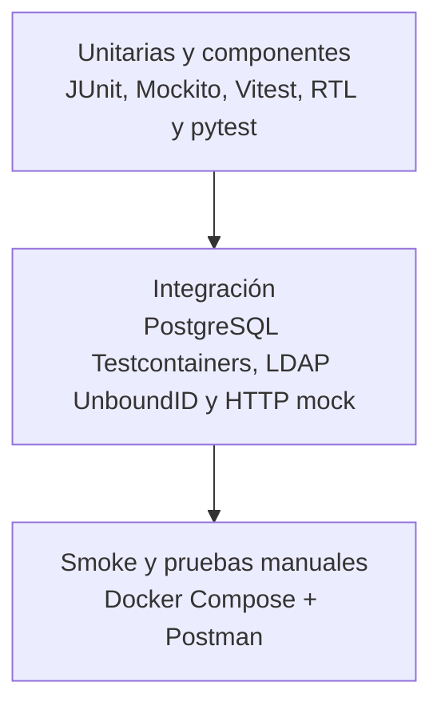

# Estrategia y evidencia de testing

**Fecha de corte:** 19 de noviembre de 2026
**Referencia de código:** `origin/main` al preparar la TASK-171

## Inventario verificable

| Componente | Evidencia versionada | Inventario |
|---|---|---|
| Backend Java | `src/test/java` | 54 archivos `*Test.java`, 7 archivos `*IT.java`, 431 anotaciones `@Test` |
| Frontend | tests colocalizados en `src/` | 45 archivos; la suite documentada contiene 208 pruebas |
| IA/ML | `anomaly-detection/tests/test_training_pipeline.py` | 6 casos del pipeline de entrenamiento |
| Manual/E2E | Postman y `Guia_Testing_Login_Federado.md` | login, OAuth, panel, seguridad, EDA, anomalías y Analítica |

Los conteos describen el repositorio y no reemplazan el resultado de una ejecución. La evidencia definitiva de cada entrega es el run de CI asociado al commit presentado.

## Pirámide de pruebas



## Comandos reproducibles

Backend:

```bash
cd login-federado
mvn test
mvn verify
```

Frontend:

```bash
npm ci
npm run lint
npm run typecheck
npm run test:coverage
npm run build
```

IA/ML:

```bash
cd anomaly-detection
python -m pytest -q
```

Entorno integrado:

```bash
cd login-federado
docker compose up --build -d
docker compose ps -a
```

## Gates documentados

- Backend: JaCoCo declara 60 % de líneas en fase `verify`.
- Frontend: Vitest declara 60 % para statements, branches, functions y lines.
- Calidad: Checkstyle, SonarCloud, Gitleaks y Trivy forman parte de los workflows.
- Accesibilidad: jest-axe, foco, teclado y viewport móvil complementan los tests funcionales.

## Limitaciones conocidas

- Sin `maven-failsafe-plugin`, Maven no descubre automáticamente los siete `*IT.java`; deben ejecutarse explícitamente o incorporarse a Failsafe.
- El CI de backend ejecuta `mvn test jacoco:report`, por lo que el `jacoco:check` asociado a `verify` no actúa como gate en ese job.
- Los smoke tests validan despliegue y salud, pero no sustituyen una prueba multi-squad completa.
- Un reporte de cobertura generado localmente no se versiona; se publica o conserva como artefacto del pipeline.

## Evidencia mínima para la entrega

1. URL y SHA del run verde de backend.
2. URL y SHA del run verde de frontend.
3. Resultado de la batería manual relevante para la demo.
4. Consulta de `event_outbox` sin filas inesperadas en `FAILED`.
5. Captura o registro del evento recibido por EDA y del tablero de Analítica.
